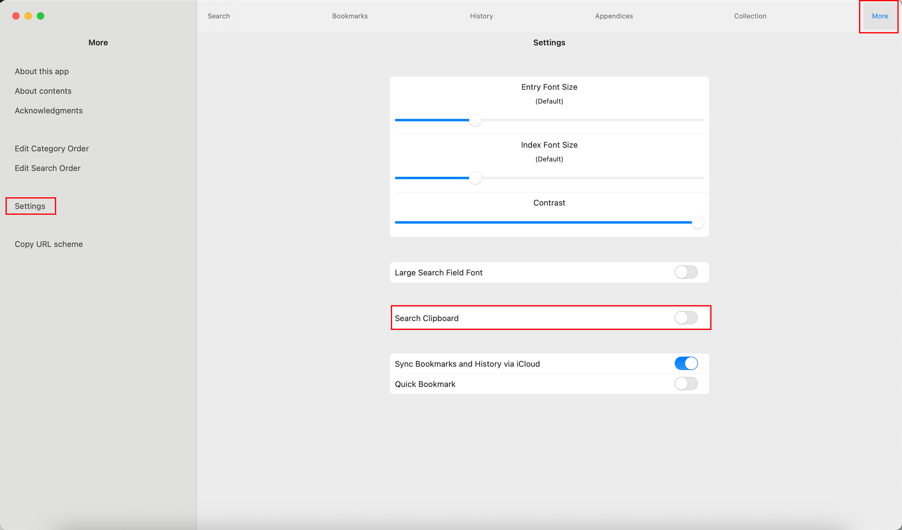
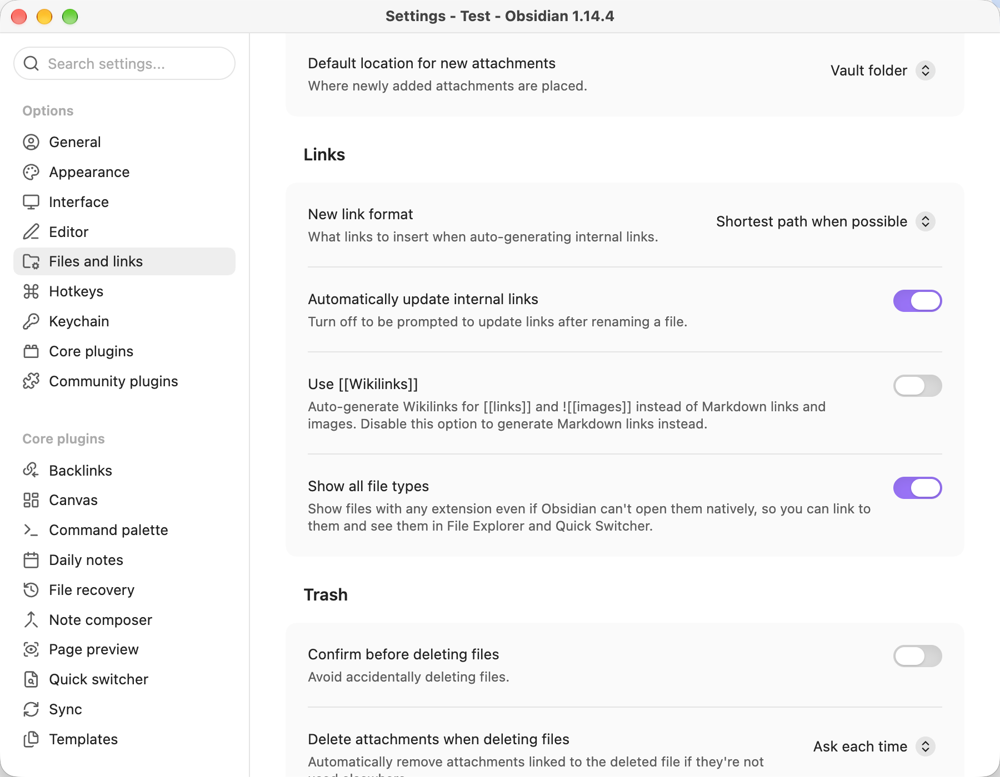

# 常见问题解答

问：我看到提示信息「物書堂で引きました」，但物书堂辞典那边没有任何反应。不过查询历史被记录在了 Copilot History 文件中。是我的设置有问题吗？（我用的是 Mac）。

答：请确保在 Mac 上的物书堂辞典的设置中**启用**了「剪贴板搜索」功能。

问：我希望在新仓库使用已经设置好的辞典，该怎么做？

答：可以先备份原仓库的辞典配置，再在新仓库中参照备份进行设置。目前插件支持复制和导出，尚不支持直接导入 JSON 文件。

1. 在原仓库打开插件设置，找到「辞書リンクのバックアップ」（辞典链接备份）。
2. 点击「コピー」将配置复制为 JSON 文本，粘贴到文本编辑器中保存；或点击「JSON をエクスポート」，将配置保存到原仓库根目录的 `monokakido-dictionaries.json`。如果已有同名文件，文件名会自动添加数字后缀，实际路径以保存成功的提示为准。
3. 在新仓库安装并启用插件，打开插件设置。
4. 参照备份中的 `dictURL` 填写默认辞典 URL，再按照 `dialogDictCategories` 的顺序添加辞典，将每项的 `label` 填入按钮名称、`url` 填入辞典 URL。请保留 URL 中的 `<text_to_search>`、`<文字列>` 或 `{w}` 占位符。

**导出成功却找不到 JSON 文件？** Obsidian 默认关闭「显示所有文件类型」（Show all file types），因此导出的 JSON 文件可能不会出现在 Obsidian 的文件列表中。请前往「设置 → 文件与链接（Files and links）」开启该选项，或直接使用系统文件管理器（如 Finder、资源管理器）到原仓库根目录查找。

开启该选项只会让文件显示在列表中，并不代表 Obsidian 可以直接查看 JSON 内容，请使用文本编辑器打开。

请注意，备份包含默认辞典 URL，以及追加辞典的名称、URL 和排列顺序，不包含查词历史或其他插件设置。另外，建议将备份另存到仓库以外的位置。
